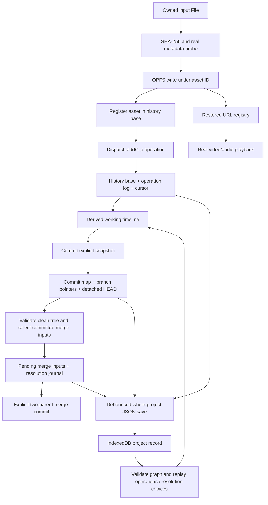

# Cutroom adversarial QA

Date: 2026-10-30. Revision: `254fb521c8ff57fda8a1b2da5122e469e63b54d5`.
Production tested: https://cutroom-editor.vercel.app/?demo=1.

## Executive verdict: NO-GO for trusting real editing work

The **committed-only merge invariant held in the tested paths**, including dirty
clip/metadata/import states, Undo/Redo, pending merges, refresh, fast-forward and
repeated merges. Criss-cross histories fail closed rather than choosing an
arbitrary base. This is evidence of a sound merge foundation, not a proof of all
possible executions or full Git compatibility.

Persistence is not yet trustworthy. Four new defects were reproduced and filed:
three P1 issues and one P2. Two can leave a saved historical snapshot without its
media or lose a newer commit after the UI explicitly reports saved. Passing the
existing suite did not detect these failures.

No production code, existing tests, configuration or dependencies were changed.
No commits, pushes, merges or deployments were made. The only untracked handoff files
are this report and owned `qa/adversarial/` fixtures. Evidence, generated media
and profiles are in ignored `.gstack/adversarial-qa/`; local build output was
also regenerated. All browser profiles were disposable;
no existing personal project/account/session was used. GitHub issue creation and
updates were explicitly authorized. Existing issues were not closed.

## Scope and test accounting

The audit began from a clean checkout. Local source/build and production behavior
were tested separately. Production reproduced the five prior fixes and all four
new findings. AI requests used HTTP fixtures; no paid model calls were made.

The deployed entry assets are retained in
[production-assets.json](.gstack/adversarial-qa/production-assets.json), including
`main-DrLRV26Z.js` and `Timeline-B3kYsdbj.js`. No authenticated deployment-SHA
endpoint was used: the SHA above identifies the audited checkout. Production
behavior is established by the browser evidence, not by assuming that pushing
implies deployment or identical build flags.

Counts below use each final test case or browser journey group once. Replays,
individual assertions inside loops, warm-up iterations and superseded harness
failures are not inflated into additional passing tests. Browser groups are
coarser than Vitest cases; the separate totals matter.

| Suite | Executed | Passed | Failed | Runner-skipped |
| --- | ---: | ---: | ---: | ---: |
| Unmodified engine/web/performance-script baseline | 766 | 766 | 0 | 0 |
| New seeded graphs, replay and committed-only cases | 2,025 | 2,025 | 0 | 0 |
| Pure stress cases | 4 | 4 | 0 | 0 |
| Minimal Undo/media-retention regression | 1 | 0 | 1 | 0 |
| Standalone drop/quota, import/checkout and stale-save regressions | 3 | 0 | 3 | 0 |
| Local media/import/restart journey groups | 14 | 14 | 0 | 0 |
| Production prior-issue journey groups | 4 | 4 | 0 | 0 |
| Production walkthrough/recovery journey groups | 9 | 9 | 0 | 0 |
| Extra production/export/mobile and interruption groups | 5 | 5 | 0 | 0 |
| Browser history/graph stress groups | 3 | 3 | 0 | 0 |
| Browser checkout/render stress groups | 4 | 4 | 0 | 0 |
| **Total cases/journey groups** | **2,838** | **2,834** | **4** | **0** |

The strict Vitest subtotal is **2,796 cases: 2,795 passed, 1 failed**. Three
additional standalone browser regressions fail, and 39 other browser journey
or stress groups pass. The four failures intentionally remain failing because
this is QA-only. Missing manual coverage is listed below; zero runner-skipped
tests does **not** mean every conceivable crash or browser was exercised.

Final TypeScript checks and production build passed. The build retains its
existing mixed static/dynamic demo-module import warning. No lint command is
configured. No dependency installation was needed.

## Architecture and implemented invariants



- `lib/vcs.ts:17` stores whole structured timelines in commits, with parents,
  author, message and timestamp. IDs such as `c4` are sequence IDs, not Git object
  hashes. Branches point to commit IDs; there is no staging area or remote asset
  transport. `currentCommit` respects detached inspection.
- `lib/mergeSession.ts:28` compares the working timeline with committed HEAD
  before classifying a merge. Three-way inputs are the committed base, ours and
  theirs. An ancestor source is an idempotent no-op; an ahead source advances the
  branch to its existing commit; genuine divergence creates a pending session.
- `vcsStore.ts` blocks dirty checkout and commits while detached. Pending merge
  resolution and commit recheck branch heads and the working snapshot through
  `assertMergeCurrent` (`mergeSession.ts:82`). Unresolved conflicts block commit.
  Cancel removes pending state without changing the graph or working edits.
- `packages/engine/src/merge.ts` compares clip fields, merges metadata, then
  sweeps the resulting geometry. Independent valid clip edits can overlap only
  when combined; per-clip comparisons cannot discover that collision. The
  engine asks for a choice rather than shifting creative timing automatically.
- Resolution identity uses structured conflict keys and explicit choices.
  Geometric conflicts are refreshed after resolution; meaningful unrelated
  field/metadata conflicts survive. Pending persistence saves inputs and a
  journal, not a trusted clean flag or precomputed merged result.
- History replay uses a base, log and applied cursor. Undo moves the cursor;
  Redo replays the same operation. A new edit after Undo truncates the redo tail.
  Tested reducer paths do not rewrite existing commit snapshots.
- `lib/persistence/project.ts:151` validates project schema, operation replay,
  branch heads, parents and graph cycles. Schemas 1 and 2 are readable; new saves
  use 2. Invalid pending sessions recover with a notice while valid project
  history remains. Raw corrupt project data is retained for rescue.
- `usePersistence.ts:126` asynchronously saves one complete JSON project in an
  IndexedDB transaction, with a 700ms debounce for ordinary changes. That
  transaction protects one metadata record, but does not make OPFS and history
  atomic or correctly acknowledge concurrent save revisions: see #9.

Paths above are under `apps/web/src/` unless a package path is shown.

## Confirmed new findings and fix order

### 1. P1 — older autosave acknowledges a newer unsaved commit (#9)

**Issue:** https://github.com/ShivamChavan01/cutroom/issues/9

**Observed, twice in production:** with a first native IDB write delayed,
create `First snapshot` (`c4`), then `Second snapshot` (`c5`). Release the older
write before the newer debounce fires. UI shows saved and main at `c5`; actual
IndexedDB still points to `c4`. Reload loses the second commit.

**Expected:** saved acknowledges the latest captured revision. An older in-flight
completion cannot clear newer unsaved/saving state.

**Root cause:** `usePersistence.ts:126–139` captures history/repo, awaits the write,
then sets saved unconditionally. Subscriptions can meanwhile schedule newer work.
There is no captured-revision acknowledgement or single-flight coordination.

**Fault model:** native transactions are kept alive with harmless reads, then
complete normally. The test does not fabricate success callbacks or project data.

**Minimal failing command:** `node qa/adversarial/save-race.regression.mjs`.
Evidence: [first/repeat observations](.gstack/adversarial-qa/save-race/result-first.json),
[repeat](.gstack/adversarial-qa/save-race/result.json),
[false saved screenshot](.gstack/adversarial-qa/save-race/false-saved.png).

Fix this first: it invalidates the user's durability signal, including the
README's instruction to wait for saved before refreshing.

### 2. P1 — Delete → Undo removes recoverable imported media (#6)

**Issue:** https://github.com/ShivamChavan01/cutroom/issues/6

**Observed, twice in production without fault injection:** import a new video
without committing, Delete its clip, Undo, commit the restored clip, refresh.
The clip and commit survive but the source is gone. Preview reports media not
local; the status reports a missing stored file. In both runs a 276,413-byte file
existed before deletion and was absent after Undo.

**Expected:** bytes referenced by recoverable Undo/Redo states remain available.

**Root cause:** `lib/actions.ts:27–40` physically deletes media when
`lib/media/references.ts:26` finds no current clip or commit reference. That count
omits the operation history that can restore the uncommitted import. The existing
session URL masks the deletion until reload.

**Minimal failing command:**
`./node_modules/.bin/vitest run qa/adversarial/media-retention.regression.test.ts`.
It uses real stores/reducer/history/actions and spies only on physical deletion.
The spy receives the source ID although Undo restores that source.

Evidence: [production observations](.gstack/adversarial-qa/media-browser/results.json),
[missing committed media](.gstack/adversarial-qa/media-browser/undo-missing-1.png),
[minimal failure](.gstack/adversarial-qa/media-retention-results.json).

The original external input file is not deleted; Cutroom's persisted copy is.
Reimport is necessary. Protect recoverable references or defer collection rather
than broadening automatic deletion.

### 3. P1 — drop import hides OPFS/quota failure (#7)

**Issue:** https://github.com/ShivamChavan01/cutroom/issues/7

**Observed:** with the same injected OPFS failure, Add video shows the error;
dropping the file onto the timeline creates the clip and reports saved without
that warning. A second standalone production regression confirms the missing
warning. Actual video probing, hashing and metadata saving run normally.

**Expected:** both entrypoints explain that media is session-only when its
persistent write fails, and report skipped/unreadable files.

**Root cause:** `components/Timeline.tsx:217` discards the entire upload report.
`components/UploadButton.tsx:16` handles its `storageWarning` and `skipped` fields.
`lib/upload.ts` deliberately allows temporary session playback after OPFS failure.

**Minimal failing command:** `node qa/adversarial/drop-quota.regression.mjs`.
Evidence: [A/B observations](.gstack/adversarial-qa/media-browser/results.json),
[drop without warning](.gstack/adversarial-qa/media-browser/quota-drop.png),
[picker control](.gstack/adversarial-qa/media-browser/quota-picker.png).

### 4. P2 — in-flight import crosses a checkout boundary (#8)

**Issue:** https://github.com/ShivamChavan01/cutroom/issues/8

**Observed, twice in production:** hold native writable creation during an import
started on `main`; switch to clean `alternate`; release the write. The imported
asset and addClip operation appear on alternate, without confirmation. Heads
remain `main:c2`, `alternate:c3`: this is an ownership race, not another dirty
merge contamination defect.

**Expected:** bind the import to its origin, cancel it explicitly on checkout, or
block checkout while the import is pending.

**Root cause:** `lib/upload.ts:134` rereads the global current editor after awaits
and registers/inserts into whichever timeline is current. No origin/session token
is validated. Checkout only sees already-materialized working edits.

**Minimal failing command:** `node qa/adversarial/import-race.mjs`.
Evidence: [exact observation](.gstack/adversarial-qa/import-race/result.json),
[screenshot](.gstack/adversarial-qa/import-race/wrong-branch.png).

Existing issues were fetched and inspected before filing. Each new issue includes
expected/actual behavior, severity, root-cause paths, reproductions and a minimal
fixture or self-contained DevTools fault script. Public bodies contain synthetic
IDs/media descriptions only, no keys, account data or personal footage.

## Existing issues #1–#5

All remain **OPEN** in GitHub; none was automatically closed.

| Issue | Classification at audited revision and production | Evidence |
| --- | --- | --- |
| #1 Fast-forward | Fixed and regression-tested | Advance to existing source commit, unchanged commit count, branch-only OPFS video decodes/plays, refresh restores exact head |
| #2 Negative timing | Fixed and regression-tested | Rejected Enter/blur drafts reset, associated inline errors; valid edits Undo/Redo and reload correctly |
| #3 Dirty merge contamination | Fixed and regression-tested | Dirty movement, trim, audio, tags, project, transform, split/delete, track/source registration and multiple edits rejected without state mutation; also after restore and during pending merge |
| #4 Repeated merges | Fixed and regression-tested | Already-integrated source is a no-op after a genuine two-parent merge and again after refresh |
| #5 Tags Undo/Redo | Fixed and regression-tested | Undo tags leaves prior trim intact; Redo/commit/branch switch/refresh retain intended snapshots |

See [production issue results](.gstack/adversarial-qa/production-issues/results.json)
and `qa/adversarial/invariants.test.ts`. Fixing #5 did not address physical media
collection (#6), and #9 is independent of committed-only merge input selection.

## Complex graphs and independent oracle

New graph seeds **1–1000** use a generator bounded to 5–20 nodes; these seeds exercised 8–14-node acyclic graphs. Each checks six head
pairs against an independent Floyd–Warshall transitive-closure oracle: **6,000
new pair comparisons**. The unmodified baseline also exhausts all 1,024
five-node DAGs in its chosen topological order across 25 head pairs (25,600
comparisons). These loops are not counted as separate Vitest test cases.

The explicit criss-cross fixture is:

```
c0: []
c1: [c0]
c2: [c0]
c3: [c1, c2]
c4: [c2, c1]
heads: c3, c4
best common ancestors: [c1, c2]
```

Neither best base dominates the other. `findMergeBases` returns both;
`findMergeBase`/`prepareMerge` reject with the multiple-base error and leave inputs
unchanged. Cutroom does not implement Git's recursive/virtual merge-base strategy.
First-parent display history intentionally omits merged-in side stories while
ancestry traversal follows both parents.

| Requested graph class | Executed coverage | Result |
| --- | --- | --- |
| Linear; divergent; ancestor/descendant; fast-forward | Named fixtures, seed graphs, existing VCS tests, production issue journey | Pass |
| Repeated/already-integrated merges | Seed operation fixtures and production repeated-merge flow | Pass |
| Multiple bases; criss-cross | Exact fixture above, independent oracle, existing merge-base tests | Fail closed as intended |
| Deeply nested two-parent commits | 10,000-node iterative traversal fixture | Pass; no recursive stack failure |
| Diamond; three collaborating branches | Named graph plus three-branch merge/serialization workflow | Pass |
| Identical independent edits/splits; conflicting edits | Existing real engine tests and seeded committed histories | Pass |
| Delete versus modify | Existing merge/resolution tests in baseline | Explicit conflict retained |
| Deletion/recreation; empty commits; equivalent trees | New workflow fixture with three branches and explicit API empty commit | Pass; empty commit is API-supported, UI normally disables unchanged commits |
| Unrelated histories | Named graph and existing tests | No common base; merge rejected |
| Missing parents/heads, self-cycle, multi-node cycle | New serialized corruption fixtures | Parser rejects |

Low-level traversal tolerates missing parent references in a manually constructed
`Repo`; it is not a universal validator. Persisted user data crosses the strict
parser, which rejects those references. No new bug was filed solely for feeding
an invalid typed object directly to a trusted internal helper.

## Media model, import results and limitations

Actual import path: File selection/drop → metadata probe plus SHA-256 → OPFS
write → asset registration → addClip operation → save/commit/branch → checkout
or merge → URL restoration → playback.

- Imported IDs use the first 16 SHA-256 hex characters; bundled sample IDs use
  full content hashes. Filenames are labels, not identities.
- **Video bytes are not in commits.** Commits contain asset metadata and clip
  references. Actual bytes live in profile/origin-local OPFS. Registry entries
  map IDs to current session or bundled URLs.
- Asset registration intentionally changes history's base without an undoable
  source-import operation. Adding the timeline clip is the history operation.
  Undoing the import clip retains its library source. Tag edits now have their
  own undoable operations. This documented policy is not a newly filed defect.
- Successful imports and decoded playback were checked for a small MP4, a
  **67,108,864-byte MP4**, WebM and audio-only WAV. The 64 MiB MP4 is the short
  original CC0 study plus an ISO-BMFF free box, so it stresses hashing/storage
  size, **not** long-GOP or hour-long decode complexity.
- Corrupt MP4, zero-byte MP4 and unsupported binary input are rejected without
  changing the timeline/history/repo in the picker path.
- Same content reuses the same source and stored key while receiving distinct
  clip IDs. Same bytes under another name preserve existing metadata; different
  bytes under the same filename remain distinct assets. No hash collision was
  manufactured; 64-bit-prefix collision resistance was not experimentally proven.
- Uncommitted import reload/Undo/Redo and explicit commit snapshots passed.
  Previously committed media survived removal on another branch, checkout,
  fast-forward deletion and inspection of its old commit, including reload.
  **Uncommitted undoable references fail collection safety: #6.**
- Clearing or evicting OPFS can leave valid commits referencing missing bytes.
  Recovery/playback warnings communicate this; metadata alone cannot recreate
  footage. Another browser/profile cannot automatically restore local work.
  Timeline export is not a portable media package or complete graph backup.
- Graceful close/restart of an owned persistent Chrome profile preserved an exact
  saved graph and its real OPFS media. This does not prove power-loss durability.
- The collection helper considers every stored commit, including older commits.
  It ignores recoverable history (#6). No complete background garbage collector
  or orphan-file reclamation policy was demonstrated.

Media is self-created repository CC0 motion/sound, looped/transcoded only for
this audit. No third-party copyrighted footage was downloaded. See
`apps/web/public/demo/README.md` and the rerun commands below.

## Interruption and recovery matrix

| Interrupted phase / fault | Executed result | Boundary |
| --- | --- | --- |
| Import while metadata callback pending | Reload preserves exact prior graph | Native metadata delivery held; no new clip acknowledged |
| Native writable creation pending | Reload preserves prior graph/timeline | Import can still cross checkout if allowed to finish: #8 |
| Bytes written, writable close not completed | Reload preserves prior graph | Unreferenced/empty orphan cleanup not proven |
| Timeline edit and ordinary commit before debounce | Unsaved is visible; immediate reload loses new in-memory work | Known 700ms durability window, not evidence of a completed durable commit |
| Older save finishing after a newer commit | **FAIL #9**: false saved label, newer commit lost after refresh | Both real transactions and reload exercised, with injected latency |
| Branch checkout | Committed snapshot loads exactly; saved branch/media survive refresh | An in-flight import can target the new branch: #8 |
| Merge preparation | Unresolved session restores with same parents/base/conflict | Production four-size flow |
| Partial and full resolution | Choices replay; remaining conflicts retained; no automatic commit | Production two-conflict fixture, repeated refresh |
| Merge commit | Saved two-parent graph and resolved timeline survive reload | Does not exempt merge commits from generic save-ack race #9 |
| Restoration / corrupt project | Explicit rescue UI/raw data retained; stale merge canceled with notice | Own profiles and malformed seeded project only |
| IDB write quota failure | Actionable error; previous saved graph survives reload | Native put throws a synthetic quota failure |
| OPFS failure | Picker warns; **drop fails warning contract (#7)** | Session playback remains possible until refresh |
| Missing stored media / failed decode | Warnings visible; no fabricated healthy source | Production missing/decode fixtures plus real missing source in #6 |
| Tab closure and browser restart after saved | Exact graph and OPFS source survive | Graceful persistent-profile close/relaunch, not process kill or power loss |

There is no claim of crash-proof storage. In particular, an actual process kill
mid-native-write, OS/disk power loss, and interrupted project rehydration at every
possible await were not exhaustively exercised. The initial loading screen does
block editor controls until hydration completes (`App.tsx:80`).

## Performance and stress results

Environment: AMD Ryzen 5 3500U, 8 logical CPUs, approximately 5.7 GiB RAM,
Linux `7.2.13-1-liquorix-amd64`, Node `v24.17.0`, Chrome `156.0.8078.79`.
Swap and other local work were present; no CPU isolation/governor control was
applied. These are local observed samples, not production SLAs or best-case
benchmark claims. Total session elapsed was not measured.

Pure measurements use one warm-up and five measured invocations; medians below
are milliseconds. Graph histories have small empty timelines and 10 or 100
branches. They do not multiply 10,000 commits by 1,000 independent clip snapshots.
Pointer-only checkout is an object update, **not** decoded media readiness.

| Commits | Branches | Merge base | Pointer checkout | Serialize | Parse/validate | Graph layout | JSON bytes |
| ---: | ---: | ---: | ---: | ---: | ---: | ---: | ---: |
| 100 | 10 | 0.5574 | 0.0023 | 0.2130 | 1.8028 | 0.3908 | 25155 |
| 100 | 100 | 0.7128 | 0.0037 | 0.2364 | 1.5720 | 1.1832 | 26225 |
| 1000 | 10 | 1.5730 | 0.0012 | 1.9661 | 12.2229 | 2.6559 | 252864 |
| 1000 | 100 | 1.5486 | 0.0012 | 2.9812 | 17.8441 | 2.6593 | 254034 |
| 10000 | 10 | 42.2856 | 0.0012 | 43.9973 | 137.8182 | 79.3972 | 2574873 |
| 10000 | 100 | 47.0849 | 0.0011 | 29.0160 | 144.2732 | 56.2324 | 2576133 |

A separate clean merge of **1,000 clips and 5,001 assets** took a median **19.62 ms**. Full samples and Node process memory observations: [primary stress samples](.gstack/adversarial-qa/stress-primary.json).

Browser rendering is a **local Vite development build**, not a production-render benchmark. Each row is one fresh Chrome context with 100 branches and the small real sample timeline. Times include automation/visibility checks.

| Commits | History visible ms | Graph visible ms | Return to Media ms | Observed graph JS heap MiB | Graph DOM nodes | Origin storage bytes |
| ---: | ---: | ---: | ---: | ---: | ---: | ---: |
| 100 | 807.67 | 506.09 | 364.17 | 19.78 | 2449 | 77996 |
| 1000 | 1166.27 | 1306.40 | 499.98 | 58.00 | 9649 | 98476 |
| 10000 | 7138.95 | 8677.52 | 669.41 | 77.79 | 81649 | 307372 |

Browser checkout includes the real VCS store, snapshot load and two animation frames; each exact timeline/branch comparison passed. These are single observations, with the small timeline except the explicit 1,000-clip row.

| Commits | Clips | Checkout through two animation frames ms |
| ---: | ---: | ---: |
| 100 | 4 | 166.50 |
| 1000 | 4 | 193.00 |
| 10000 | 4 | 140.10 |
| 10 | 1000 | 1321.60 |

The 10,000-commit UI is slow despite a much faster pure graph algorithm. This is
a **P2 performance observation**, not a newly invented latency guarantee or a
filed correctness issue. Consider history/graph virtualization and formatter
reuse after data safety is repaired. Profiling is required before attributing
all cost to a particular component.

JS heap comes from Chrome CDP, not total browser/native decoder RSS or a peak
memory proof. Origin storage estimates are highly compressible synthetic graph
metadata, not footage capacity. The 64 MiB media file's exact persisted byte
size was separately checked. Browser timing results: [rendering](.gstack/adversarial-qa/browser-stress/results.json),
[checkout](.gstack/adversarial-qa/checkout-stress/results.json).

## Production browser coverage and traceability

All production cases used fresh local browser profiles against the deployed
origin. No server-side project data exists in this prototype; browser writes
stayed in owned IndexedDB/OPFS. Screenshots and exact saved JSON comparisons
were used together. The walkthrough explicitly exercised 1920×1080, 1440×900,
1280×800 and 1024×768. A 390×844 viewport showed the desktop limitation notice;
full mobile editing is not supported or claimed.

Production native JSON was actually downloaded and parsed: four sample clips
were present. MP4 export remains unavailable and is explained. The command
palette opened/closed with Ctrl+K/Escape; tag/numeric histories exercised Undo,
Redo and keyboard deletion. The optional guide, branches, comparison, graph,
merge/cancel/resolve/commit, 1,200ms gap finding, refresh, reset and project
isolation passed the normal flow. Error/access/rate AI states were fixtures,
not live paid inference.

| Requirement | Executed tests / evidence | Status and practical limit |
| --- | --- | --- |
| Architecture / actual data flow | Source paths and diagram above, unmodified baseline | Inspected; no claim of full Git parity |
| 20 graph-history classes | `graphs.test.ts`, `invariants.test.ts`, baseline merge/VCS tests | Covered as graph table above; criss-cross explicitly unsupported |
| Independent merge-base oracle | 1,000 seeded Floyd–Warshall scenarios plus baseline exhaustive DAGs | Pass |
| Only committed merge inputs | 11 dirty categories, Undo/Redo, pending drift, rejection identity checks; production issues flow | No contamination observed |
| Merge references/cancellation/conflicts | Real two-parent commit and resolution journals; production four-size and partial-merge flows | Pass on tested paths |
| Import formats and filenames | `functional-browser.mjs`, exact byte/hash/count comparisons, real decoded playback | 14 groups pass; maximum input 64 MiB |
| Uncommitted import history | Save/reload/Undo/Redo; Delete → Undo minimum fixture | **Collection failure #6** |
| Committed/historical media | Delete on alternate branch, checkout, fast-forward, old-commit inspection, real OPFS bytes | Pass when a commit already references the source |
| Storage warnings / invalid inputs | Picker/drop A/B, independent quota regression; corrupt/empty/binary picker cases | **Drop reporting failure #7**; picker rejects safely |
| In-flight import ownership | Held native write, checkout, release; two production runs | **Failure #8** |
| Recovery at interruption boundaries | Dedicated recovery matrix, native delayed/failed writes and reloads | Saved-state acknowledgement **fails #9**; power loss not tested |
| Saved browser restart | Owned persistent-profile close/relaunch, exact repo and decoded source | Pass for graceful restart |
| Property testing | Seeds 10001–11000: 24 edits each, replay, all captured commits immutable, Undo/Redo, round-trip and redo truncation | Pass; not exhaustive over every possible op sequence |
| Graph/property stress | 100/1,000/10,000 commits, 10/100 branches; 1,000 clips/5,001 assets | Measured; no giant cross-product fixture |
| Browser memory/storage/history responsiveness | CDP heap, origin estimate, graph DOM count, two-frame checkout | Measured locally; native decoder RSS and production-load performance unmeasured |
| Production first-time/editor/version workflow | `production-walkthrough.mjs`, `production-issues.mjs` | Pass at four requested desktop sizes |
| Missing/corrupt media / corrupt persisted graph | Actual deleted file, simulated decode failure, malformed project/merge data | Actionable recovery tested; no byte-integrity proof after arbitrary disk corruption |
| Personal isolation | Fresh personal fixture vs fresh demo namespace, reset and reload exact-byte comparisons | Pass; no real personal project touched |
| GitHub duplicates and issue status | Original bodies + refreshed issue snapshots under evidence root | #1–#5 left open; #6–#9 newly filed with reproducible evidence |
| TypeScript / production build | `typecheck.log`, `build.log` | Pass; no lint command configured |

Evidence entrypoints:

- [Count manifest](.gstack/adversarial-qa/final-summary.json)
- [Final complete audit results](.gstack/adversarial-qa/all-audit-results.json)
- [Generated results](.gstack/adversarial-qa/generated-results.json)
- [Baseline log](.gstack/adversarial-qa/baseline.log)
- [Production previous-issue results](.gstack/adversarial-qa/production-issues/results.json)
- [Production viewport/recovery results](.gstack/adversarial-qa/production-walkthrough/results.json)
- [Format/import/restart results](.gstack/adversarial-qa/functional-browser/results.json)
- [Extra recovery/mobile/export results](.gstack/adversarial-qa/extra-browser/results.json)
- [Current GitHub issue snapshot](.gstack/adversarial-qa/issues-final.json)

Expected injected HTTP 404/401/429 and decode/storage errors are retained in the
production report; they are not presented as unexpected production outages.
Normal production journeys reported no page exceptions.

## Harness corrections and unsuccessful commands

The initial results remain under the evidence directory. None of these harness
problems was filed as an application bug:

- An early media reproduction looked for an inspector Delete button that was
  not present in the current inspector view; the replay selects the clip and
  uses the actual Delete keyboard action instead.
- A historical-media fixture initially only focused a clip after checkout,
  which does not select it. Its deletion did nothing and Commit stayed disabled.
  The corrected fixture presses Enter to select; the entire 14-group media suite
  then passed, including exact timeline checks and historical media.
- The first 10,000-row browser stress used an unscoped accessibility lookup over
  the huge graph and timed out finding Media. Scope was narrowed to the actual
  sidebar control, without changing the action or assertions. All three sizes
  then completed. That earlier timeout alone did not establish an application
  crash; captured page exceptions were empty.
- Adding checks for every captured commit accidentally inserted a variable
  reference outside its fixture scope, yielding 11 `ReferenceError`s. The
  accidental duplicate was removed, the stronger checks remained, and all 2,025
  generated/named cases passed on replay. Original harness output is retained.
- A native export probe initially assumed a different menu label. Using the
  real `Cutroom timeline` label produced a real JSON download and successful
  clip-data comparison.
- An isolated fixture typecheck needed the existing Vite ambient declarations
  from the app's package context. Fixture-only typing issues were corrected;
  production configuration was not touched. A shared audit Playwright loader
  now uses `PLAYWRIGHT_MODULE` or an existing installed Playwright package.
- A GitHub connector query rejected its argument shape. The authenticated `gh`
  CLI successfully read issues and created/updated only the authorized findings.

Four regression failures are **product failures**, not harness corrections:
Undo-media collection, ignored drop warning, import ownership, and stale save
acknowledgement. Their assertions were not weakened and their tests remain
failing against this revision.

## Rerun instructions

Use Node/Chrome and the repository's existing dependencies. No test command
below modifies production code or existing projects. All browser scripts create
owned profiles. These exact commands refer to this local audit handoff; the QA
fixtures are intentionally **uncommitted**, so a new clone does not yet contain
them. Set `PLAYWRIGHT_MODULE` to the existing module path on your machine when
Playwright is not resolvable as an installed package.

```sh
export PLAYWRIGHT_MODULE=/home/shivam/.gstack/repos/gstack/node_modules/playwright/index.mjs
mkdir -p .gstack/tmp .gstack/adversarial-qa/media

# Required local servers, in separate terminals; production scripts use HTTPS.
pnpm --dir apps/web dev --host 127.0.0.1 --port 5186 --strictPort
pnpm --dir apps/web build
pnpm --dir apps/web preview --host 127.0.0.1 --port 5187 --strictPort

# Unmodified baseline: expected pass.
TMPDIR=$PWD/.gstack/tmp ./node_modules/.bin/vitest run packages/engine apps/web scripts/measure-editor-performance.test.mjs --maxWorkers=3
pnpm typecheck
pnpm --dir apps/web build

# Generated positive invariants and pure stress: expected pass.
TMPDIR=$PWD/.gstack/tmp ./node_modules/.bin/vitest run qa/adversarial/graphs.test.ts qa/adversarial/invariants.test.ts qa/adversarial/stress.test.ts --maxWorkers=2
./node_modules/.bin/tsc -p qa/adversarial/tsconfig.json --noEmit

# Confirmed defects: each is expected to FAIL at 254fb52.
./node_modules/.bin/vitest run qa/adversarial/media-retention.regression.test.ts
node qa/adversarial/drop-quota.regression.mjs
node qa/adversarial/import-race.mjs
node qa/adversarial/save-race.regression.mjs

# Real media reproduction / control and passing journeys.
node qa/adversarial/media-browser.mjs
node qa/adversarial/functional-browser.mjs
node qa/adversarial/production-issues.mjs
node qa/adversarial/production-walkthrough.mjs
node qa/adversarial/extra-browser.mjs
node qa/adversarial/browser-stress.mjs
node qa/adversarial/checkout-stress.mjs
```

`EDITOR_URL=http://127.0.0.1:5187/` can redirect the standalone defect and copied
production scripts to the local production build. `functional-browser`,
`checkout-stress` and `browser-stress` deliberately use local development modules
for exact store inspection. Production and browser evidence must not be conflated.

No failing random seed was found. New failures were reduced to the deterministic
workflow fixtures named above; random-failure shrinking was therefore unnecessary.

To recreate the self-created input set:

```sh
cp apps/web/public/demo/motion.mp4 .gstack/adversarial-qa/media/small.mp4
cp apps/web/public/demo/pulse.wav .gstack/adversarial-qa/media/audio.wav
ffmpeg -v error -stream_loop -1 -i apps/web/public/demo/motion.mp4 -t 20 -c copy .gstack/adversarial-qa/media/long.mp4
ffmpeg -v error -i apps/web/public/demo/motion.mp4 -t 3 -an -c:v libvpx-vp9 -deadline realtime -cpu-used 8 .gstack/adversarial-qa/media/sample.webm
```

The large MP4 is created by appending a correctly sized ISO-BMFF `free` box to
`small.mp4` to reach 64 MiB; the corrupt/zero/binary inputs are synthetic bytes.
Exact fixture creation and provenance are in `qa/adversarial/README.md`.

## Remaining limits and next action

1. Repair #9 save acknowledgement and #6 recoverable-media retention before
   trusting the editor with real work. Test delayed writes, concurrent edits,
   Undo/Redo and saved/reloaded commits, not just reducer outputs.
2. Route every import report through consistent UI handling (#7).
3. Give asynchronous imports explicit branch/workspace ownership (#8), with
   checkout/cancellation tests.
4. Re-run all four failing regressions against fixes and repeat production
   verification before considering existing issues resolved.
5. Then profile large history/graph rendering and real long-form seeking/export
   constraints. Passing metadata merge tests does not demonstrate smooth editing.

Still unproven or unsupported: actual process-kill/power-loss durability; full
mobile editing; other browser engines; same-workspace concurrent tabs (already a
documented limitation); automatic cross-browser/cloud media restoration; files
larger than 64 MiB or realistic hour-long codec/GOP workloads; exhaustive byte
integrity after arbitrary disk corruption; native decoder/RSS peak memory; and
production-load performance. No new issues were invented for these limitations.

The founder walkthrough works in its controlled path. This audit does **not**
authorize a claim that Cutroom can safely retain arbitrary real editing work yet.
