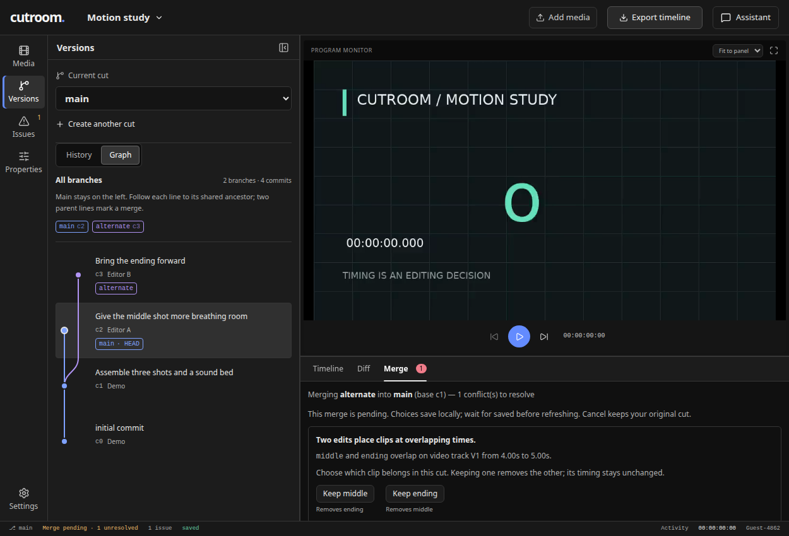

# Cutroom

**Version control for video edits, in the browser.** One cut gives the middle shot another second on screen. Another brings the ending forward. Both play fine on their own. Combine them and two shots want the same second. Cutroom shows where the cuts disagree, lets the editor choose which shot stays, and saves a new version that traces back to both cuts.

**[Try the guided sample](https://cutroom-editor.vercel.app/?demo=1)** · [Open your own workspace](https://cutroom-editor.vercel.app/) · [Editor guide](docs/editor-guide.md)

[](https://cutroom-editor.vercel.app/?demo=1)

## Make the edit

Open the sample in desktop Chrome. The footage and two alternate cuts are already there. No account, upload or AI access code is needed.

1. Open **Motion study → Sample guide → See two versions**. In **Versions**, switch between the cuts or open **Graph** to see where they split.
2. In the guide, choose **Compare edits**, then **Merge versions**. The middle shot runs from 3–5 seconds in one cut. The ending starts at 4 seconds in the other.
3. Choose **Keep middle**, enter a merge message and select **Commit merge**. This removes the competing ending shot. Choose **Inspect findings** and jump to the 1.2-second gap on V1. Play it and decide whether the pause belongs.

## What you can do with your own footage

The November 2026 release added full-resolution editing copies for faster seeking, coordinated playback when a track stalls, review against a saved production brief, audio gain suggestions, and safeguards for projects open in two tabs. [Release diff](https://github.com/ShivamChavan01/cutroom/commit/528f53a)

| Task | How it works |
| --- | --- |
| Build alternate cuts | Import video, audio and graphics. Split and trim clips, detach audio, adjust transforms and mix against waveforms. Save a cut, branch from it and compare changes clip by clip. [Editing and versions](docs/editor-guide.md#what-works) |
| Review against a brief | Save a duration limit, protect a line of dialogue or specify an order for shots. Cutroom checks these against timeline placements. The right-hand Assistant can retrieve relevant timestamped notes and preview a proposed edit. You inspect the evidence and approve the change. Visual style and continuity still need human review. Hosted AI requests require reviewer access. [Production context](docs/production-context.md) |
| Repeat an audio decision | Manually match gain on three clips from the same source and track. Select a fourth and **Properties → Audio** offers the same gain, with the three supporting edits. This suggestion runs locally for the current session. [Gain matching](docs/editor-guide.md#context-aware-gain-suggestions) |
| Resume and export | After **saved**, reopen the project with its undo history, versions and pending merge choices. Download timeline decisions as OpenTimelineIO, CMX3600 EDL or Cutroom JSON. Source media stays local. The Final Cut Pro XML option has a known compatibility issue. [Storage and recovery](docs/editor-guide.md#data-isolation-and-refresh) · [Known issues](#known-issues) |

## Engineering behind the editor

- **Merging time ranges.** The TypeScript engine compares each version with a common ancestor, combines independent changes, then checks whether clips now overlap on the same track. That last check catches the sample conflict even though the editors changed different clips. [Merge implementation](packages/engine/src/merge.ts) · [Merge tests](packages/engine/src/merge.test.ts)
- **Keeping playback in sync.** A single video sets the pace when its decoder stalls. With multiple active tracks, the player pauses them together and reuses loaded media across cuts. A three-minute fixture with 240 clips across four tracks exercised stall recovery and audio alignment. [Player](apps/web/src/components/Player.tsx) · [Multitrack benchmark](scripts/measure-multitrack.mjs)
- **Scrubbing long footage.** When a drag jumps far ahead, the player can replace an obsolete seek. Across 60 matched jumps on a ten-minute 720p clip, median time to the target frame fell from 496 ms to 293 ms. Fast continuous sweeps still showed few intermediate frames. [Seek traces and method](PERF.md#replacing-an-obsolete-seek-during-a-large-jump)
- **Seeking through 4K footage.** In desktop Chrome on a Vega 8 laptop, a full-resolution editing copy reduced median click-to-frame time from **1.74 s to 0.36 s** across six matched positions on one 12-second upscaled 4K clip. Preparing it took 58 seconds and 30 MiB of extra storage. The timeline keeps referencing the original. On the same machine, software-decoded 8K still played below real time. [Measurements and limitations](PERF.md#source-resolution-playback-and-editing-copies) · [Encoder](apps/web/src/lib/media/encodeEditingCopy.ts)
- **Constraining Assistant edits.** Retrieval ranks authored notes by words and source-time overlap. The request records what fit and what was omitted. Before applying a proposal, the editor checks that the cut and brief are still current and that the change preserves required constraints. [Retrieval](apps/web/src/lib/production/context.ts) · [Placement checks](apps/web/src/lib/production/review.ts) · [Proposal scope](apps/web/src/lib/assistant/scope.ts)
- **Protecting local work.** IndexedDB checks the last observed snapshot and writes the new one in the same transaction. A stale tab reports a save failure before it can overwrite newer edits. Imported media lives separately in the browser’s origin-private file system. [Storage implementation](apps/web/src/lib/persistence/storage.ts) · [Concurrent save tests](apps/web/src/lib/persistence/storageConcurrency.test.ts)

## Known issues

- **Final Cut Pro handoff.** The sample export fails FCPXML 1.10 validation. It puts a `story` element where the sequence requires a `spine`, and its assets lack the required `media-rep` elements. The export test currently expects the same invalid structure. [Exporter](packages/engine/src/export/fcpxml.ts) · [Export tests](packages/engine/src/export/export.test.ts)
- **Reimporting a source switches preview back to the original.** Importing the same footage again adds another clip to the timeline. It also replaces the source URL, which deactivates the editing copy for that asset. [Import path](apps/web/src/lib/upload.ts) · [Editing-copy handling](apps/web/src/lib/media/editingCopy.ts)
- **Import memory on large files.** Cutroom reads the entire file into memory to hash it on each import. In a test with the same fixture imported three times, all three object URLs remained readable for one asset. Peak browser memory on multi-gigabyte camera originals remains unmeasured. [File hashing](apps/web/src/lib/upload.ts) · [Asset URL registry](apps/web/src/lib/assets.ts)

## Run it locally

Use Node.js 24 and the pinned pnpm version in `package.json`. Run these commands from the repository root.

```sh
pnpm install --frozen-lockfile --ignore-scripts
pnpm dev
```

Open the URL printed by Vite. The editor and sample work without credentials. [Optional Assistant setup](docs/editor-guide.md#ai-verification-assistant)

## Verification

The November 21 review passed **2,996 tests across 109 files** on Node.js 24. The editor, engine and adversarial QA typechecks passed, and Vite built the production editor. Run the combined Vitest suite from the repository root.

```sh
pnpm exec vitest run packages/engine apps/web scripts/measure-editor-performance.test.mjs qa/adversarial --maxWorkers=2
```

`pnpm test` runs the engine suite. Deployment CI runs 746 web tests and 220 engine and measurement-script tests. The combined command also runs the 2,030 adversarial checks. [CI workflow](.github/workflows/pages.yml) · [Release checks](https://github.com/ShivamChavan01/cutroom/actions/runs/44811133890) · [Adversarial fixtures](qa/adversarial/README.md) · [November progress](PROGRESS.md) · [Demo limits](DEMO-LIMITATIONS.md)
